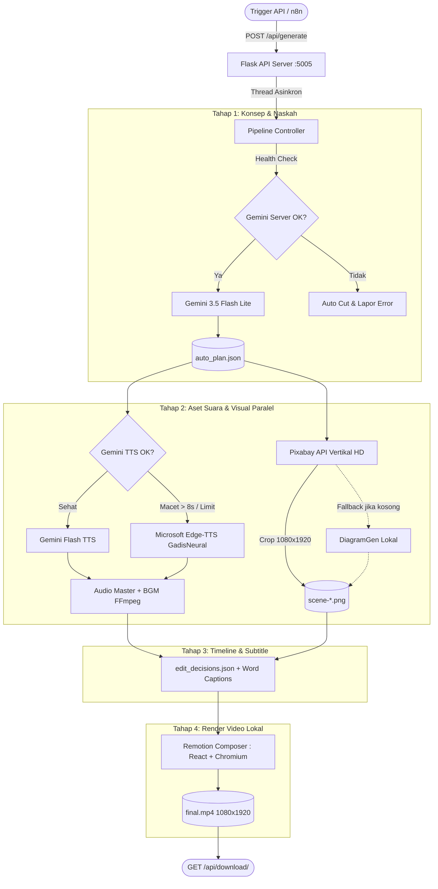

# 🎬 Auto Content Generator: Automated 9:16 Short-Form Video Pipeline

Pipeline otomatisasi produksi video pendek format vertikal (9:16) untuk **TikTok**, **Instagram Reels**, dan **YouTube Shorts**. Sistem ini menggabungkan kecerdasan buatan Google Gemini, kurasi aset visual Pixabay HD, sintesis suara multi-engine (Gemini TTS + Auto-Fallback Edge-TTS), dan perakitan video berbasis kode menggunakan **Remotion**.

---

## 🌟 Fitur Utama

- **🧠 AI Scriptwriter & Director (Google Gemini 3.5 Flash Lite)**
  Membuat naskah video 5 adegan yang terstruktur, hook yang menarik, hook visual, statistik, perbandingan, diagram, serta prompt pencarian visual yang relevan.
- **🛡️ Real Google Server Health Check (Anti-Hardcode)**
  Memeriksa kesehatan model secara langsung ke server Google (mengambil metadata resmi, display name, dan token limit). Jika server Google tidak merespons dalam 8 detik, sistem langsung melakukan auto-cut atau beralih ke jalur fallback tanpa membuat proses macet (*bengong*).
- **🎙️ Dual-Engine Voiceover dengan Non-Blocking Auto-Fallback**
  - **Primer:** Google Gemini Interactions TTS (`gemini-3.8-flash-tts`) dengan pilihan suara natural (*Kore, Puck, Fenrir, dll.*).
  - **Sekunder (Fallback):** Microsoft Edge-TTS (`id-ID-GadisNeural`) yang dikonversi otomatis ke WAV 44.1kHz mono. Berjalan seketika jika kuota Google habis atau koneksi TTS Google macet > 8 detik.
- **🖼️ Smart Visual Engine (Pixabay HD 9:16 + Diagram Fallback)**
  Mengambil stok foto atau ilustrasi vertikal beresolusi tinggi dari Pixabay API, kemudian melakukan auto center-crop dan resize presisi ke **1080x1920**. Jika kuota/stok kosong, sistem otomatis membuat diagram infografis modern via `DiagramGen`.
- **⚡ Dynamic Word-Level Captions**
  Subtitle kata demi kata yang disinkronkan secara matematis dengan durasi audio tiap scene, siap ditampilkan dengan animasi highlight pop-up di Remotion.
- **🎥 Local Remotion Engine (No Timeout Limit)**
  Perakitan video dilakukan secara lokal menggunakan Chromium headless dan FFmpeg, tanpa batasan timeout sehingga render video berkualitas tinggi tetap aman hingga selesai 100%.
- **🤖 REST API Siap Integrasi n8n**
  Menyediakan endpoint background worker asinkron (`/api/generate`, `/api/status/<job_id>`, `/api/download/<job_id>`) untuk automasi terjadwal via n8n, Make, atau webhook kustom.

---

## 📐 Arsitektur Alur Kerja (Workflow)



---

## 📂 Struktur Direktori

```text
auto_content/
├── app.py                      # Flask Server utama, health-check, worker, dan API routes
├── .env                        # Konfigurasi API keys (Gemini, Pixabay)
├── requirements.txt            # Daftar dependensi Python
├── lib/                        # Pustaka utilitas pembantu
├── projects/                   # Direktori output proyek (audio, gambar, naskah, render)
│   └── <project-slug-id>/
│       ├── assets/             # Audio wav, BGM mp3, gambar visual 9:16
│       ├── artifacts/          # auto_plan.json
│       └── renders/            # final.mp4
├── remotion-composer/          # Engine perakitan video berbasis React & Remotion
│   ├── package.json
│   ├── src/                    # Template scene (stat_card, callout, comparison, hero)
│   └── public/
├── schemas/                    # JSON schema untuk validasi manifest dan edit decisions
├── styles/                     # Template styling visual
└── tools/                      # Tool adapter
    ├── audio/                  # Adapter Gemini TTS
    ├── graphics/               # Adapter Pixabay, Google Imagen, DiagramGen
    └── video/                  # VideoCompose adapter penghubung Remotion
```

---

## 🛠️ Prasyarat Sistem

Pastikan perangkat/server Anda telah terpasang:
1. **Python 3.10+**
2. **Node.js 18+ & npm** (diperlukan untuk menjalankan engine render Remotion)
3. **FFmpeg & FFprobe** terinstal di sistem dan dapat diakses dari terminal:
   ```bash
   ffmpeg -version
   ffprobe -version
   ```

---

## 🚀 Panduan Instalasi & Setup

### 1. Masuk ke Direktori Proyek
```bash
cd /home/tessar/workspace/ai_workflow/auto_content
```

### 2. Konfigurasi Virtual Environment Python
```bash
python3 -m venv .venv
source .venv/bin/activate
pip install --upgrade pip
pip install -r requirements.txt
pip install flask edge-tts
```

### 3. Konfigurasi Node Dependencies (Remotion)
```bash
cd remotion-composer
npm install
cd ..
```

### 4. Setup Environment Variables (`.env`)
Buat atau edit file `.env` di root direktori `auto_content`:
```env
# Google Gemini API Key (dari Google AI Studio)
GEMINI_API_KEY=AIzaSy...

# Pixabay API Key (gratis untuk stok foto & vektor HD)
PIXABAY_API_KEY=your_pixabay_api_key_here
```

---

## 🏃 Cara Menjalankan Server

Jalankan server Flask menggunakan Python dari virtual environment:

```bash
# Menjalankan di foreground
./.venv/bin/python app.py
```

Server akan aktif di:
```text
🚀 OpenMontage Gemini Automation API berjalan di http://127.0.0.1:5005
```

> **Tips Production / Background:**  
> Untuk menjalankan di background secara persisten:
> ```bash
> nohup ./.venv/bin/python app.py > server.log 2>&1 &
> ```

---

## 📡 Dokumentasi Endpoint REST API

### 1. Buat Video Baru (`POST /api/generate`)
Menginisiasi antrean produksi video di background.

- **URL:** `http://127.0.0.1:5005/api/generate`
- **Method:** `POST`
- **Header:** `Content-Type: application/json`
- **Body:**
  ```json
  {
    "topic": "Bahaya kecanduan doom scrolling bagi otak anak muda",
    "voice_id": "Kore"
  }
  ```
  *(Opsi `voice_id` untuk Gemini TTS: `Kore`, `Puck`, `Fenrir`, `Aoede`, `Charon`)*

- **Contoh Request (cURL):**
  ```bash
  curl -X POST http://127.0.0.1:5005/api/generate \
    -H "Content-Type: application/json" \
    -d '{"topic": "Bahaya kecanduan doom scrolling bagi otak anak muda"}'
  ```

- **Response (202 Accepted):**
  ```json
  {
    "job_id": "4b68a8dc4e8f",
    "message": "Produksi video dimulai di background",
    "status_url": "http://127.0.0.1:5005/api/status/4b68a8dc4e8f"
  }
  ```

---

### 2. Cek Status Produksi (`GET /api/status/<job_id>`)
Memantau kemajuan proses produksi video.

- **URL:** `http://127.0.0.1:5005/api/status/<job_id>`
- **Method:** `GET`

- **Contoh Request (cURL):**
  ```bash
  curl http://127.0.0.1:5005/api/status/4b68a8dc4e8f
  ```

- **Response Saat Sedang Berjalan (`running`):**
  ```json
  {
    "job_id": "4b68a8dc4e8f",
    "status": "running",
    "step": "4/4 - Merender video 9:16 di Remotion (~4-5 menit)...",
    "topic": "Bahaya kecanduan doom scrolling bagi otak anak muda",
    "created_at": "2026-10-25T13:00:00.000000+00:00"
  }
  ```

- **Response Setelah Selesai (`completed`):**
  ```json
  {
    "job_id": "4b68a8dc4e8f",
    "status": "completed",
    "step": "Selesai!",
    "project_id": "bahaya-kecanduan-doom-scrolling-4b68a8",
    "visual_mode": "pixabay",
    "title": "Stop Doom Scrolling Sekarang!",
    "caption": "Otak kamu bisa rusak gara-gara scrolling tanpa henti. Simak penjelasannya!",
    "hashtags": ["#faktaotak", "#mentalhealth", "#tipsfokus"],
    "video_path": "/home/tessar/workspace/ai_workflow/auto_content/projects/bahaya-kecanduan-doom-scrolling-4b68a8/renders/final.mp4",
    "download_url": "http://127.0.0.1:5005/api/download/4b68a8dc4e8f",
    "completed_at": "2026-10-25T13:04:30.000000+00:00"
  }
  ```

---

### 3. Unduh Video Hasil Render (`GET /api/download/<job_id>`)
Mengunduh file video MP4 (1080x1920) jika status sudah `completed`.

- **URL:** `http://127.0.0.1:5005/api/download/<job_id>`
- **Method:** `GET`

- **Contoh Download via Terminal:**
  ```bash
  curl -O -J http://127.0.0.1:5005/api/download/4b68a8dc4e8f
  ```

---

## 🔗 Integrasi Automasi dengan n8n

Pipeline ini dirancang untuk diintegrasikan dengan workflow n8n secara mulus:

```text
[Schedule / Webhook Trigger]
            │
            ▼
[HTTP Request Node: POST /api/generate]
            │ (dapatkan job_id)
            ▼
┌─────► [Wait Node: 30 detik]
│           │
│           ▼
│       [HTTP Request Node: GET /api/status/{{ $json.job_id }}]
│           │
└────── [If Node: status != "completed"?]
            │ (Jika completed)
            ▼
[HTTP Request Node: GET /api/download/{{ $json.job_id }}]
            │ (Binary File MP4)
            ▼
[Upload ke TikTok / Instagram Reels / YouTube Shorts Node]
```

---

## ⚙️ Detail Mekanisme Kesehatan & Fallback

1. **Non-Blocking Daemon Thread Timeout (`run_with_timeout`)**:
   Berbeda dengan `ThreadPoolExecutor` bawaan yang sering macet pada operasi I/O socket hang, fungsi ini menggunakan `threading.Thread(daemon=True)` dengan `queue.Queue()`. Jika waktu melebihi batas (misal 8 atau 15 detik), thread langsung ditinggalkan tanpa memblokir thread utama.
2. **Health Check Google Model**:
   Sebelum memanggil naskah, sistem mengirim `client.models.get(model=...)`. Dari situ diperiksa nilai `name`, `display_name`, dan batas token. Tidak ada status yang di-hardcode.
3. **Penyelamat Edge-TTS**:
   Jika Google TTS mengembalikan HTTP 429 (Resource Exhausted) atau socket hanging, sistem otomatis beralih ke engine `edge-tts` lokal dengan suara wanita Indonesia alami (`id-ID-GadisNeural`) dan mengonversi format ke WAV standar industri. Produksi video tidak pernah gagal karena masalah kuota TTS.
4. **Remotion Local Render**:
   Rendering video menggunakan GPU/CPU lokal melalui Chromium headless. Timeout pada tahap ini ditiadakan agar video berdurasi panjang tetap selesai dengan sempurna.

---

## 📄 Lisensi & Kontributor

Dikembangkan untuk kebutuhan produksi konten otomatis di ekosistem **OpenMontage** / **AI Workflow**.
Semua komponen kode, adapter, dan template scene bebas dimodifikasi sesuai kebutuhan spesifik saluran konten Anda.
