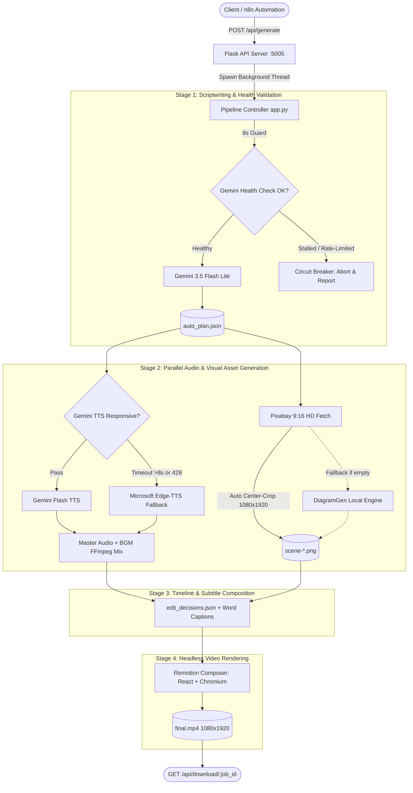

# 🎬 Auto Content Pipeline: Automated 9:16 Video Production API

An autonomous, production-grade video generation service tailored for **TikTok**, **Instagram Reels**, and **YouTube Shorts**. 

This system integrates **Google Gemini** for AI scriptwriting and directorship, a resilient **dual-engine voiceover pipeline** with zero-downtime fallback, automated **Pixabay HD visual curation**, and code-driven programmatic video rendering powered by **Remotion**.

---

## 🏛️ System Architecture & Engineering Attribution

This repository is architected with a clean separation between the **Application Orchestration Layer** and the **Foundational Media Toolset**:

| Layer | Implementation | Description |
| :--- | :--- | :--- |
| **Application & Pipeline Controller** | [`app.py`](file:///Users/taufiq/workspace/auto_content/app.py) *(Custom Implementation)* | Core Flask REST API, asynchronous worker thread queue, Google Gemini health checks, resilient dual-engine TTS fallback, visual asset preprocessing (center-crop 1080x1920), word-level caption synchronization, and job lifecycle management. |
| **Underlying Media Toolset & Engine** | `lib/`, `tools/`, `schemas/`, `styles/` | Integrated from the open-source **[OpenMontage](https://github.com/calesthio/openmontage)** framework (GNU AGPL-3.0), providing low-level media primitives, schema definitions, and Remotion composition bridges. |

---

## 🌟 Key Engineering Highlights

- **🧠 Autonomous Scriptwriter & Director (Google Gemini 3.5 Flash Lite)**  
  Generates structured 5-scene JSON plans featuring compelling narrative hooks, visual prompts, key statistics, comparisons, and scene timing.
- **🛡️ Anti-Stall Health Checks & Timeout Protection**  
  Uses non-blocking daemon threads (`run_with_timeout`) to guard against hung network sockets. Directly validates Google Gemini model metadata (`display_name`, token limits) with an 8-second circuit breaker before committing compute resources.
- **🎙️ Dual-Engine Voiceover with Automatic Failover**  
  - **Primary:** Google Gemini Interactions TTS (`gemini-3.8-flash-tts`) with natural human-like voice profiles (*Kore, Puck, Fenrir, Aoede, Charon*).
  - **Secondary (Zero-Downtime Fallback):** Microsoft Edge-TTS (`id-ID-GadisNeural` or configured voice) converted automatically to uncompressed 44.1kHz mono WAV. Kicks in automatically if Google quota is exhausted (HTTP 429) or if synthesis stalls past 8 seconds.
- **🖼️ Smart 9:16 Visual Pipeline with Fallback Infographics**  
  Fetches high-resolution vertical imagery via the Pixabay API, automatically performing center-crop and resize to exact **1080x1920**. If imagery is unavailable or quota is exceeded, it falls back to dynamically rendered infographics via `DiagramGen`.
- **⚡ Dynamic Word-Level Captions**  
  Derives synchronized word-level timestamps directly from scene audio durations, styled for high-retention social media pop-up animations.
- **🎥 Local Headless Remotion Render Engine**  
  Renders final MP4 compositions locally using headless Chromium and FFmpeg with no arbitrary cloud timeouts.
- **🤖 n8n & Webhook-Ready REST API**  
  Exposes asynchronous background worker endpoints (`/api/generate`, `/api/status/<job_id>`, `/api/download/<job_id>`) designed for integration with automation platforms (n8n, Make, or custom webhooks).

---

## 📐 Pipeline Workflow



---

## 📂 Project Structure

```text
auto_content/
├── app.py                      # Core Flask API, health-checks, worker queue & pipeline logic
├── .env.example                # Template for environment configuration
├── requirements.txt            # Python dependencies (OpenMontage core + Flask service)
├── render_demo.py              # Test harness for Remotion compositions
│
├── remotion-composer/          # Remotion React-based rendering engine (OpenMontage component)
│   ├── package.json
│   ├── src/                    # Scene templates (callout, stat_card, comparison, hero)
│   └── public/                 # Staged assets for Chromium renderer
│
├── tools/                      # Tool adapters (OpenMontage integration)
│   ├── audio/                  # Gemini TTS, Edge-TTS, and audio mix wrappers
│   ├── graphics/               # Pixabay, Google Imagen, and DiagramGen adapters
│   └── video/                  # VideoCompose adapter bridging to Remotion
├── lib/                        # OpenMontage utility libraries (caching, config, scoring)
├── schemas/                    # JSON Schemas validating edit decisions and plans
├── styles/                     # Visual presentation style presets
└── projects/                   # Generated pipeline artifacts (audio, frames, final renders)
    └── <job_id>/
        ├── assets/             # Raw WAVs, BGM, cropped PNG scenes
        ├── artifacts/          # auto_plan.json, edit_decisions.json
        └── renders/            # final.mp4
```

---

## 🛠️ System Prerequisites

Ensure the host environment has the following installed:

1. **Python 3.10+** — [python.org](https://www.python.org/)
2. **Node.js 18+ & npm** — Required for running Remotion’s React-based video composer:
   ```bash
   node --version
   npm --version
   ```
3. **FFmpeg & FFprobe** — Required for audio analysis, resampling, and final media encoding:
   ```bash
   # macOS (Homebrew)
   brew install ffmpeg

   # Linux (Ubuntu/Debian)
   sudo apt update && sudo apt install -y ffmpeg
   ```

---

## 🚀 Installation & Setup Guide

### 1. Clone & Set Up Python Virtual Environment

```bash
git clone <your-repository-url>
cd auto_content

# Create and activate virtual environment
python3 -m venv .venv
source .venv/bin/activate

# Upgrade pip and install Python dependencies
pip install --upgrade pip
pip install -r requirements.txt
pip install flask edge-tts
```

### 2. Configure the OpenMontage Remotion Engine

OpenMontage uses **Remotion** as its React-based video composition engine.

1. Ensure the `remotion-composer/` directory exists. If setting up in a fresh clone where `remotion-composer` was excluded:
   ```bash
   # Clone the composer templates from OpenMontage if needed
   git clone https://github.com/calesthio/OpenMontage.git /tmp/openmontage
   cp -r /tmp/openmontage/remotion-composer ./remotion-composer
   rm -rf /tmp/openmontage
   ```

2. Install the Node.js dependencies:
   ```bash
   cd remotion-composer
   npm install
   cd ..
   ```

### 3. Configure Environment Variables (`.env`)

Copy the provided environment template:
```bash
cp .env.example .env
```

Edit `.env` with your API credentials:
```env
# Google Gemini API Key (obtain from https://aistudio.google.com/)
GEMINI_API_KEY=AIzaSy...

# Pixabay API Key (free for HD stock images from https://pixabay.com/api/docs/)
PIXABAY_API_KEY=your_pixabay_api_key_here
```

---

## 🏃 Running the Service

### Development Mode
```bash
./.venv/bin/python app.py
```
The server will initialize on:
```text
🚀 OpenMontage Gemini Automation API running on http://127.0.0.1:5005
```

### Background Daemon (Production)
To run the server in the background persistently:
```bash
nohup ./.venv/bin/python app.py > server.log 2>&1 &
```

---

## 📡 REST API Reference

### 1. Enqueue Video Generation (`POST /api/generate`)
Dispatches a new generation job to the asynchronous worker thread.

- **Endpoint:** `POST /api/generate`
- **Headers:** `Content-Type: application/json`
- **Request Body:**
  ```json
  {
    "topic": "The hidden dangers of algorithmic doom scrolling on the adolescent brain",
    "voice_id": "Kore"
  }
  ```
  *Supported `voice_id` options for Gemini TTS: `Kore`, `Puck`, `Fenrir`, `Aoede`, `Charon`.*

- **cURL Example:**
  ```bash
  curl -X POST http://127.0.0.1:5005/api/generate \
    -H "Content-Type: application/json" \
    -d '{"topic": "The hidden dangers of algorithmic doom scrolling on the adolescent brain", "voice_id": "Kore"}'
  ```

- **Response (`202 Accepted`):**
  ```json
  {
    "job_id": "4b68a8dc4e8f",
    "message": "Video production started in background",
    "status_url": "http://127.0.0.1:5005/api/status/4b68a8dc4e8f"
  }
  ```

---

### 2. Poll Job Status (`GET /api/status/<job_id>`)
Tracks the real-time progress of an in-flight job.

- **Endpoint:** `GET /api/status/<job_id>`

- **cURL Example:**
  ```bash
  curl http://127.0.0.1:5005/api/status/4b68a8dc4e8f
  ```

- **Response (`running`):**
  ```json
  {
    "job_id": "4b68a8dc4e8f",
    "status": "running",
    "step": "4/4 - Rendering 9:16 video via Remotion (~3-4 min)...",
    "topic": "The hidden dangers of algorithmic doom scrolling on the adolescent brain",
    "created_at": "2026-11-04T12:00:00.000000+00:00"
  }
  ```

- **Response (`completed`):**
  ```json
  {
    "job_id": "4b68a8dc4e8f",
    "status": "completed",
    "step": "Finished!",
    "project_id": "the-hidden-dangers-of-algorithmic-doom-scrolling-4b68a8",
    "visual_mode": "pixabay",
    "title": "Stop Doom Scrolling Now!",
    "caption": "How non-stop algorithmic feeds affect cognitive focus.",
    "hashtags": ["#BrainHealth", "#MentalFocus", "#TechDetox"],
    "video_path": "/path/to/projects/the-hidden-dangers-of-algorithmic-doom-scrolling-4b68a8/renders/final.mp4",
    "download_url": "http://127.0.0.1:5005/api/download/4b68a8dc4e8f",
    "completed_at": "2026-11-04T12:04:15.000000+00:00"
  }
  ```

---

### 3. Download Rendered Video (`GET /api/download/<job_id>`)
Downloads the final rendered vertical MP4 video once status reaches `completed`.

- **Endpoint:** `GET /api/download/<job_id>`

- **cURL Example:**
  ```bash
  curl -O -J http://127.0.0.1:5005/api/download/4b68a8dc4e8f
  ```

---

## 🔗 Automation Integration (n8n / Webhooks)

This API is designed to slot into asynchronous orchestrators like **n8n** or **Make**:

```text
[Cron / Schedule Trigger]
            │
            ▼
[HTTP Request Node: POST /api/generate]
            │ (Extracts job_id)
            ▼
┌─────► [Wait Node: 30 seconds]
│           │
│           ▼
│       [HTTP Request Node: GET /api/status/{{ $json.job_id }}]
│           │
└────── [If Node: status != "completed"?]
            │ (When completed)
            ▼
[HTTP Request Node: GET /api/download/{{ $json.job_id }}]
            │ (Binary Video Stream)
            ▼
[Social Publisher Node: YouTube Shorts / TikTok / Instagram Reels]
```

---

## 🛡️ Reliability & Fault-Tolerance Mechanisms

1. **Non-Blocking Daemon Worker (`run_with_timeout`)**: Standard Python thread pools can hang indefinitely when underlying HTTP sockets stall during streaming API requests. This service uses standalone daemon threads with `queue.Queue` timeouts: if an upstream provider stalls beyond the deadline, execution unblocks immediately.
2. **Live Gemini Health Checks**: Rather than trusting hardcoded model endpoints, the pipeline queries Google's metadata catalog (`client.models.get`) prior to script generation to verify availability and token quota.
3. **Automated Edge-TTS Fallback**: If Gemini TTS encounters quota exhaustion (HTTP 429) or latency spikes (> 8 seconds), the pipeline instantly routes synthesis to local Microsoft Edge-TTS without failing the job.
4. **Resilient Visual Engine**: Missing Pixabay stock results are seamlessly substituted with auto-generated infographic cards via `DiagramGen`, ensuring no render is ever aborted due to missing visual assets.

---

## 📄 License & Acknowledgements

- **Application & Service Code:** Custom pipeline controller, API routes, and fallback logic authored by the repository maintainer.
- **Foundational Video Engine:** Integrates components from **[OpenMontage](https://github.com/calesthio/openmontage)**, licensed under the **GNU Affero General Public License v3.0 (AGPL-3.0)**.
